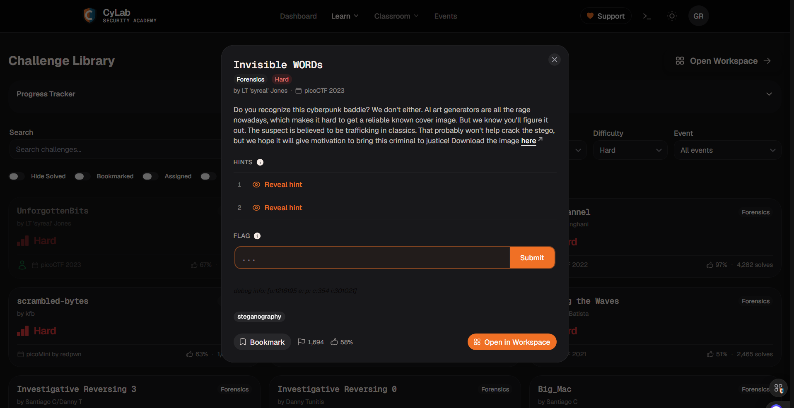
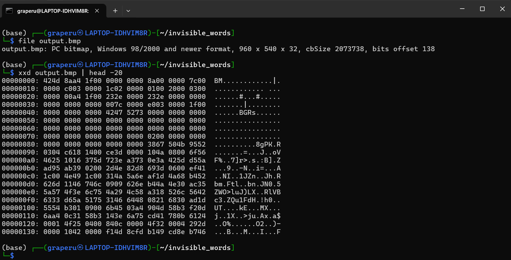
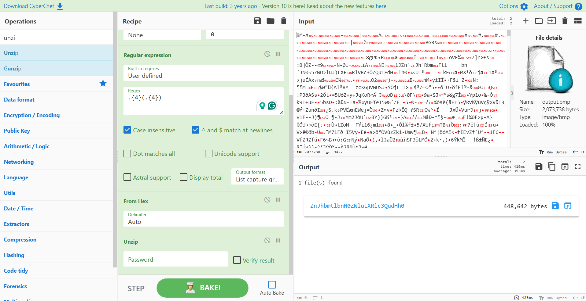
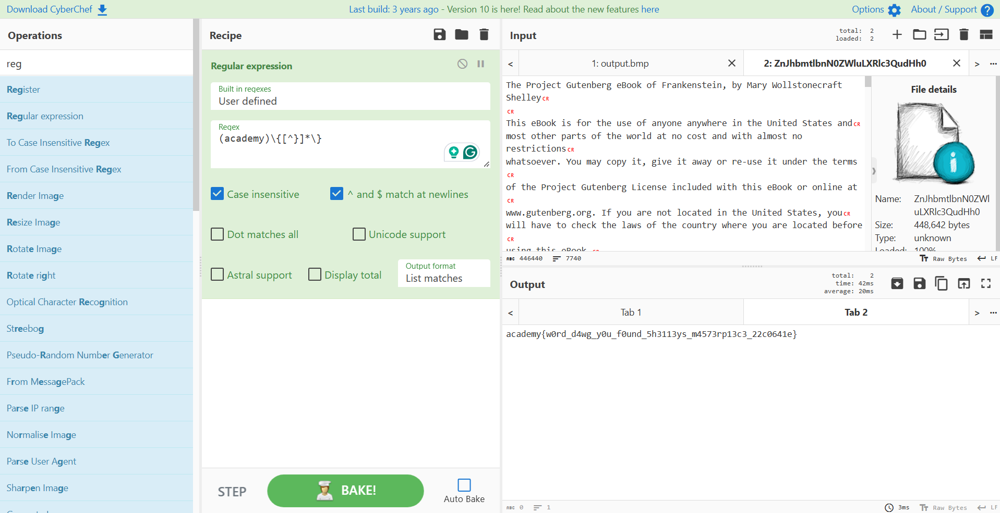
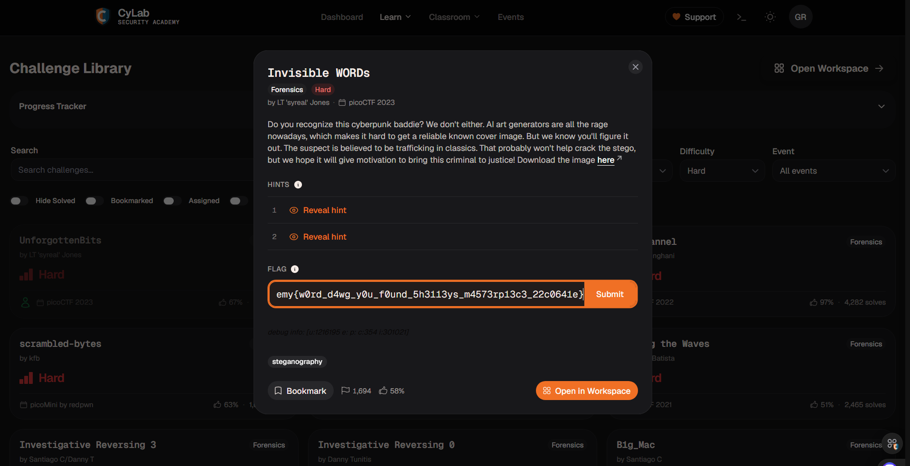
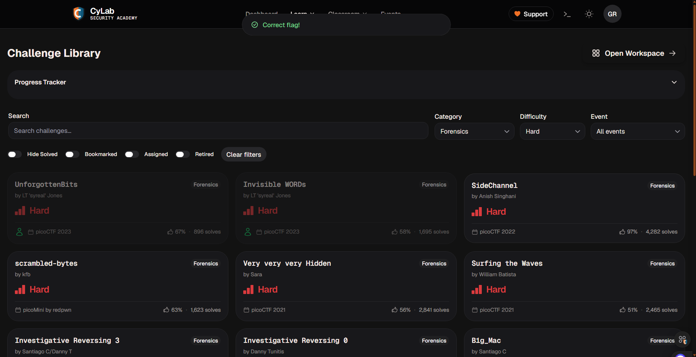

# Invisible WORDs Proof of Concept

## Challenge information

| Item | Detail |
| --- | --- |
| Challenge | Invisible WORDs |
| Platform | CyLab Security Academy (formerly picoCTF) |
| Category | Forensics |
| Files provided | A bitmap picture (`output.bmp`) |
| Flag format | `academy{...}` |



## Objective

Find the flag hidden in a bitmap picture. The picture stores 4 bytes for every pixel but only uses 2 of them for colour. The other 2 bytes of each pixel, taken together, form a ZIP archive that contains the flag.

## Key terms

| Term | Meaning |
| --- | --- |
| BMP | An uncompressed picture format. A header describes the picture, and the pixel data follows it. |
| Bits per pixel | How much space each pixel takes. This picture uses 32 bits, which is 4 bytes. |
| Colour mask | A header field that says which bits of a pixel hold red, green and blue. |
| WORD | A unit of 2 bytes. The title of the challenge refers to the 2 unused bytes in each pixel. |
| File signature | The first bytes of a file, which identify its type. A ZIP archive starts with `50 4b 03 04`, shown as `PK` in text. |
| Base64 | A way of writing any data using only letters, digits and a few symbols. |

## Tools

- Kali Linux on WSL (`file`, `xxd`)
- CyberChef

## Steps

### 1. Read the header

I used `file` and `xxd`, which shows the header information:

```
file output.bmp
xxd output.bmp | head -20
```



The output shows three things:

- The picture is 960 x 540 with 32 bits per pixel, so each pixel takes 4 bytes.
- The pixel data starts at byte 138, which is `0x8a`.
- The colour masks are `0x7c00`, `0x03e0` and `0x001f`. They cover 15 bits, 5 each for red, green and blue, so the colour fits in the first 2 bytes of each pixel. The last 2 bytes are not used by the picture.

### 2. Spot the hidden file

Starting at `0x8a`, the first four pixels are:

```
3867 504b | 9552 0304 | c618 1400 | ce3d 0000
```

The second half of each pixel reads `50 4b`, `03 04`, `14 00`, `00 00`. The first four of those bytes are the signature of a ZIP archive. The archive is stored 2 bytes at a time in the unused part of every pixel.

Tools that look for hidden files, such as binwalk, do not find it in `output.bmp`, because the bytes of the archive are never next to each other.

### 3. Extract the archive with CyberChef

I wanted to try CyberChef for this instead of writing a script. I loaded `output.bmp` as the input and built this recipe:

| # | Operation | Settings | What it does |
| --- | --- | --- | --- |
| 1 | Drop bytes | Start `0`, Length `138` | Removes the header |
| 2 | To Hex | Delimiter `None`, Bytes per line `0` | Writes each pixel as 8 hex characters |
| 3 | Regular expression | Regex `.{4}(.{4})`, Output format `List capture groups` | Keeps the last 4 characters of every 8, which are the unused 2 bytes |
| 4 | From Hex | Delimiter `Auto` | Turns the hex back into bytes |
| 5 | Unzip | No password | Opens the archive |

The result is one file of 448,642 bytes named `ZnJhbmtlbnN0ZWluLXRlc3QudHh0`.



The file name is Base64. It decodes to `frankenstein-test.txt`.

### 4. Find the flag

I opened the extracted file in a new CyberChef tab. It is the Project Gutenberg text of Frankenstein. A Regular expression operation with the regex `(academy)\{[^}]*\}` and the output format `List matches` returns the flag.



### 5. Submit the flag





## Result

The flag is `academy{w0rd_d4wg_y0u_f0und_5h3113ys_m4573rp13c3_22c0641e}`. The platform accepted it.

## Other ways to extract the archive

The same extraction works from the Kali terminal without CyberChef.

With standard shell tools:

```
tail -c +139 output.bmp | xxd -p -c 4 | cut -c5-8 | xxd -r -p > hidden.zip
unzip hidden.zip
```

With Python:

```python
OFFSET = 138  # start of pixel data, from the BMP header

data = open("output.bmp", "rb").read()[OFFSET:]
hidden = b"".join(data[i + 2:i + 4] for i in range(0, len(data), 4))
open("hidden.zip", "wb").write(hidden)
```

`unzip` may warn about extra bytes after the end of the archive. Those are the unused bytes of the remaining pixels and can be ignored.

## Why it works

The BMP header declares 32 bits per pixel, but its colour masks only describe 15 of them. Image viewers follow the masks and ignore the rest, so the picture can carry 2 bytes of unrelated data in every pixel. At 960 x 540 pixels that leaves room for about 1 MB, enough for a ZIP archive of a whole novel.

The hiding place only holds up until someone compares the header with the pixel data. The masks show that half of each pixel is unused, and the first unused bytes spell out a ZIP signature.
