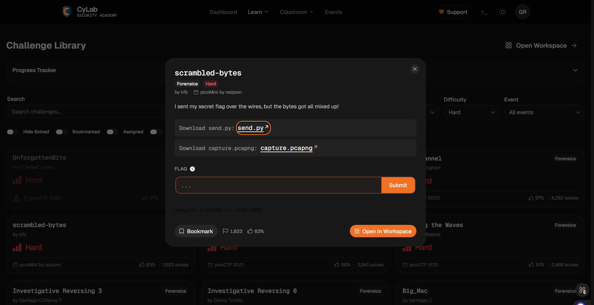
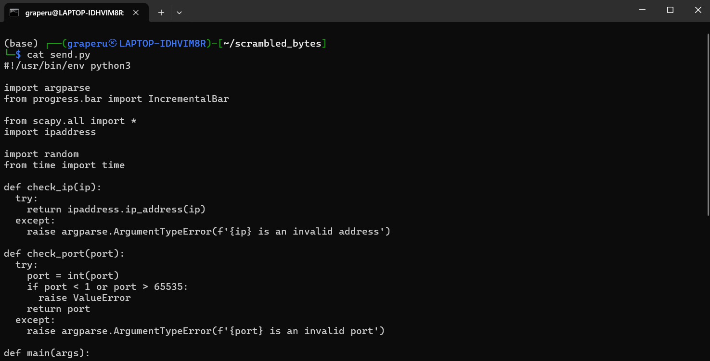
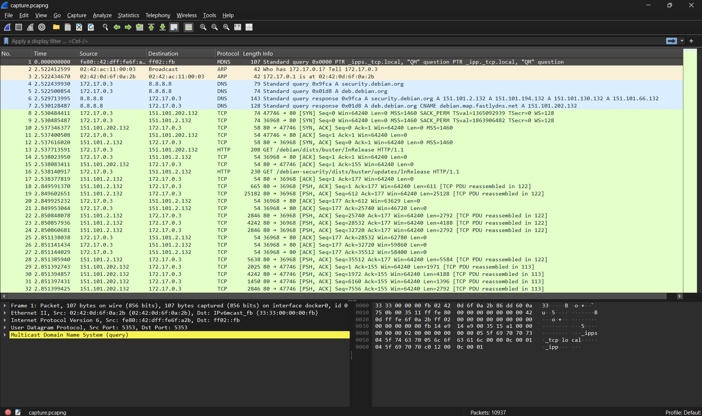
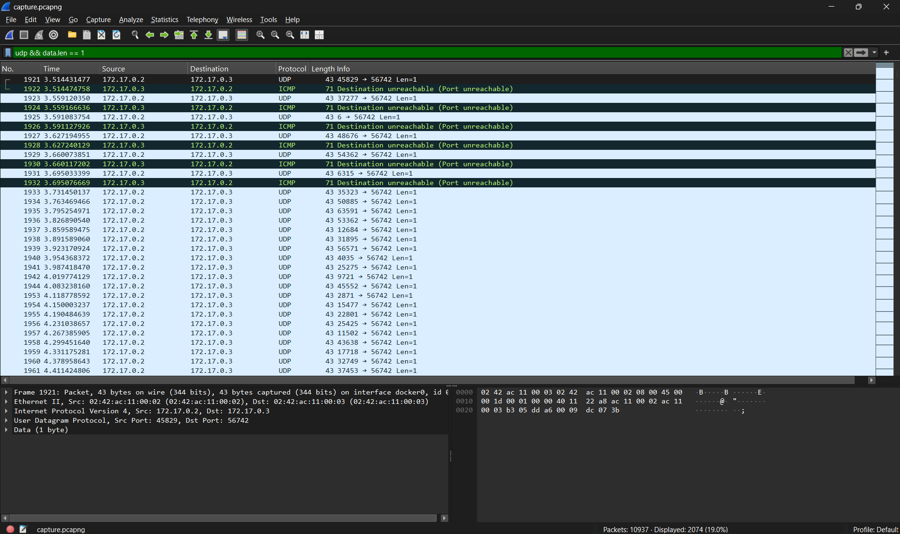
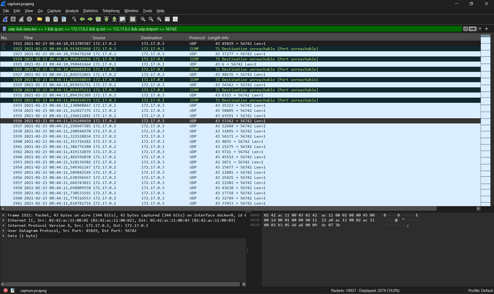
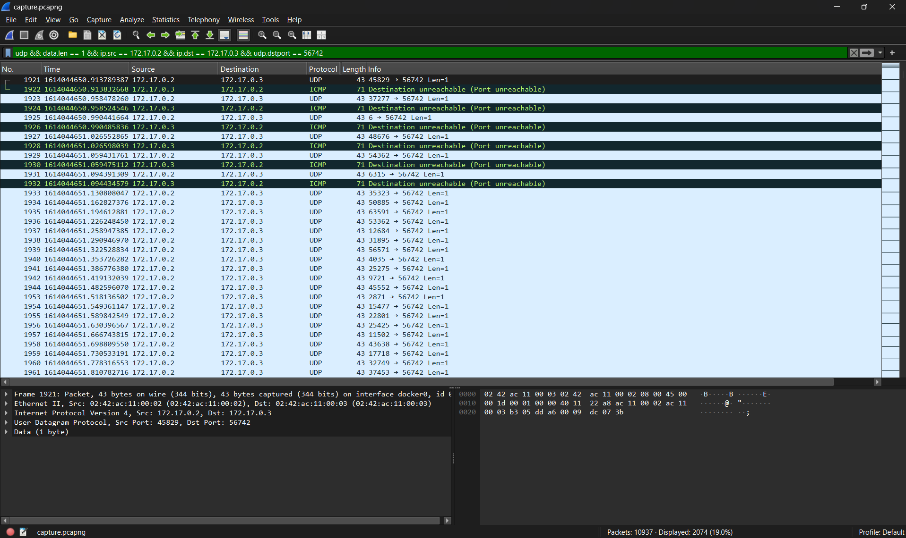
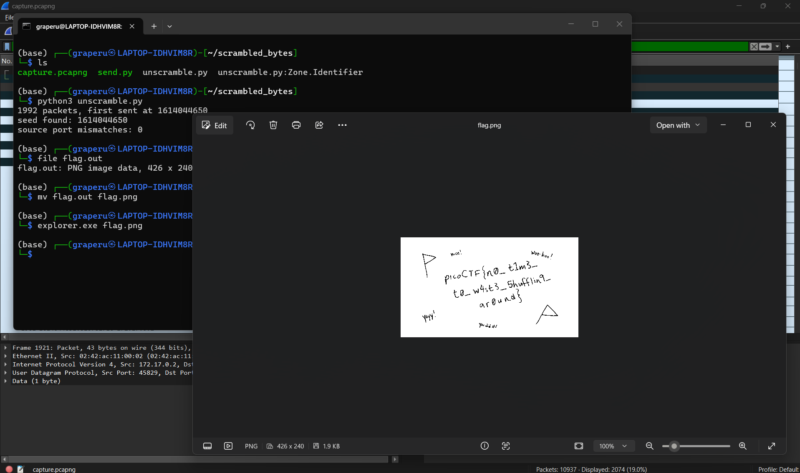
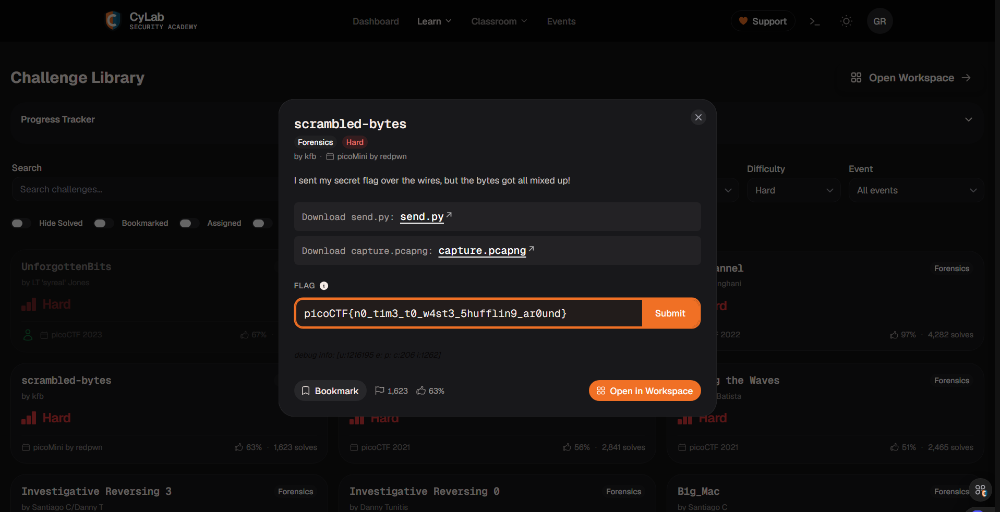
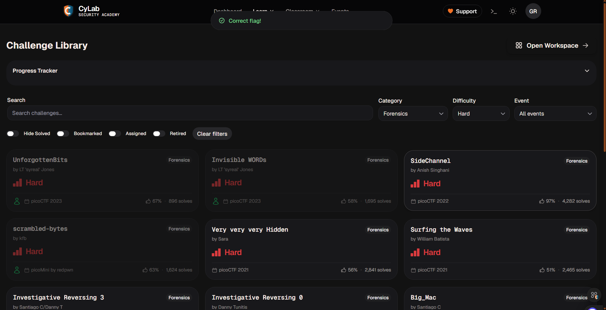

# scrambled-bytes Proof of Concept

## Challenge information

| Item | Detail |
| --- | --- |
| Challenge | scrambled-bytes |
| Platform | CyLab Security Academy (formerly picoCTF) |
| Category | Forensics |
| Files provided | A packet capture (`capture.pcapng`) and the script that sent the flag (`send.py`) |
| Flag format | `academy{...}` |



## Objective

Rebuild a file that was sent over the network one byte at a time. Before sending, the script put the bytes in a random order and disguised each one with a random number. The capture holds the scrambled bytes, and `send.py` shows how the scrambling was done.

## Key terms

| Term | Meaning |
| --- | --- |
| UDP | A network protocol that sends separate packets with no connection set up first. Each packet has a source port and a destination port. |
| Pseudo-random number generator | A program that produces numbers which look random but are calculated from a starting value. |
| Seed | The starting value of the generator. The same seed always gives the same sequence of numbers. |
| Shuffle | Putting items in a random order. With a known seed, the order can be reproduced. |
| XOR | An operation that combines two bytes. Applying the same key a second time gives back the original byte. |
| Epoch time | The number of seconds since 1 January 1970. Python's `time()` returns it. |

## Tools

- Wireshark 4.6.9 on Windows 11
- Kali Linux on WSL
- Python 3 with Scapy

## Steps

### 1. Read the sender

`send.py` does four things in its `main` function:

```python
random.seed(int(time()))
random.shuffle(payload)
...
UDP(sport=random.randrange(65536), dport=args.port) /
Raw(load=bytes([b^random.randrange(256)]))
```

- It seeds Python's random generator with the current time in whole seconds.
- It shuffles the bytes of the file.
- It sends each byte in its own UDP packet, from a random source port to one fixed destination port.
- It XORs each byte with a random number before sending.



The generator is used in a fixed order: one shuffle, then a source port and an XOR key for every byte. Anyone who knows the seed can produce the same numbers again. The seed is the time the script started, and a packet capture records times.

### 2. Find the packets in the capture

The capture has 10,937 packets, and most of them are unrelated traffic.



1. The script sends UDP packets with exactly 1 byte of payload, so I filtered on that:

   ```
   udp && data.len == 1
   ```

   
2. Statistics > Conversations, on the UDP tab with "Limit to display filter" ticked, shows that almost all of these packets go from `172.17.0.2` to `172.17.0.3` on port `56742`, each from a different source port. That matches the script: a fixed destination and a random source port for every byte.

   
3. Adding the addresses and the port to the filter leaves 1,992 packets, so the file is 1,992 bytes long:

   ```
   udp && data.len == 1 && ip.src == 172.17.0.2 && ip.dst == 172.17.0.3 && udp.dstport == 56742
   ```

   

### 3. Find the seed

I changed the time column with View > Time Display Format > Seconds Since 1970-01-01, which shows the same kind of number that `time()` returns. The first packet was sent at `1614044650`, which is 23 February 2021, 01:44:10 UTC.



The seed is that second or one shortly before it, because the script seeds the generator and then starts sending.

### 4. Reverse the scrambling

[`unscramble.py`](unscramble.py) reads the same packets with Scapy and undoes each step:

```python
# The right seed reproduces the first packet's random source port.
for seed in range(first_time - 10, first_time + 2):
    random.seed(seed)
    order = list(range(count))
    random.shuffle(order)
    if random.randrange(65536) == packets[0][UDP].sport:
        break

# Replay the generator: one shuffle, then a source port and an XOR key per byte.
random.seed(seed)
order = list(range(count))
random.shuffle(order)
original = bytearray(count)
for position, packet in zip(order, packets):
    random.randrange(65536)
    original[position] = packet[Raw].load[0] ^ random.randrange(256)
```

It works in two parts:

- It tries the seconds around the first packet as the seed. For each one it repeats the shuffle and draws the next number. The correct seed is the one where that number equals the source port of the first packet.
- With the seed known, it repeats the shuffle on a list of positions, which gives the original position of every byte. For each packet it draws the source port and the XOR key in the same order as the sender, removes the XOR and writes the byte back to its original position.

I saved the script as a file next to the capture and ran it:

```
python3 unscramble.py
file flag.out
```

The seed is `1614044650`, the same second as the first packet. All 1,992 source ports match the regenerated numbers, which confirms the seed. The rebuilt file is a PNG image, 426 x 240 pixels, and the flag is written in it.



### 5. Submit the flag





## Result

The flag is `FLAG_GOES_HERE`. The platform accepted it.

## Why it works

Python's `random` module is a pseudo-random number generator. Its output depends only on the seed, so two programs that start from the same seed get the same shuffle and the same numbers.

`send.py` used the current time in whole seconds as the seed. That value is not secret: the capture shows when the first packet was sent, which leaves only a few seconds to try. The script also put the generator's output into the source port of every packet, so each candidate seed can be checked against the capture.

For anything that has to stay secret, Python provides the `secrets` module, which takes its numbers from the operating system and has no seed to recover.
