# UnforgottenBits Proof of Concept

## Challenge information

| Item | Detail |
| --- | --- |
| Challenge | UnforgottenBits |
| Platform | CyLab Security Academy (formerly picoCTF) |
| Category | Forensics |
| Files provided | A compressed disk image (`disk.flag.img.gz`) |
| Flag format | `academy{...}` |

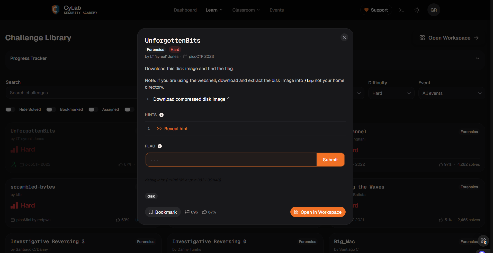

## Objective

Find the flag on a 1 GB Linux disk image. The challenge gives no hints of its own. Every clue is on the disk: a chat log, some notes, a mailbox, a browser history and four pictures.

The flag is in an encrypted file hidden inside one of the pictures. Getting to it takes a password that the user only half remembered and a decryption key that is not stored in any file.

## Key terms

| Term | Meaning |
| --- | --- |
| Disk image | A file that holds an exact copy of a whole disk, including deleted data and unused space. |
| Partition | A section of a disk that holds its own file system. |
| Steganography | Hiding data inside another file, such as a picture, so that the file still looks normal. |
| steghide | A tool that hides data in pictures and audio files and protects it with a passphrase. |
| AES-256-CBC | A symmetric cipher. Decrypting needs the same key and IV that were used to encrypt. |
| Salt, key and IV | The values the `openssl enc` command needs to decrypt a file when no passphrase is used. |
| Wordlist attack | Trying every password from a prepared list until one works. |
| Unallocated space | Parts of a disk that no file currently uses. Old data can remain there. |
| Golden ratio base (base phi) | A way of writing numbers with only 0s and 1s, where each position is worth a power of the golden ratio (about 1.618) instead of a power of 2. |

## Tools

- Autopsy 4.23.1 on Windows 11
- Kali Linux on WSL
- steghide 0.6.0
- StegSeek 0.6
- OpenSSL
- Python 3

## Steps

### 1. Open the disk image

1. Unpack the image with `gunzip -k disk.flag.img.gz`.
2. In Autopsy, create a new case and add `disk.flag.img` as a Disk Image data source. I left the ingest modules on their defaults. When the analysis finished, Autopsy had flagged two encryption programs under Interesting Items, which gave me an early idea of what to expect.

   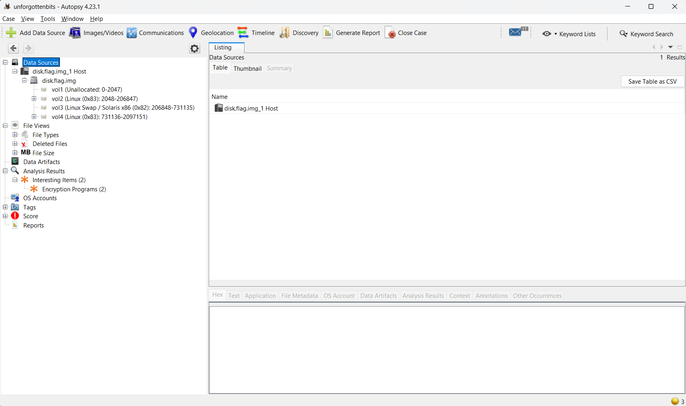
3. Expand Data Sources. The image has four volumes. `vol4` is the main Linux partition, and `/home/yone` holds five folders: `.lynx`, `gallery`, `irclogs`, `Maildir` and `notes`.

   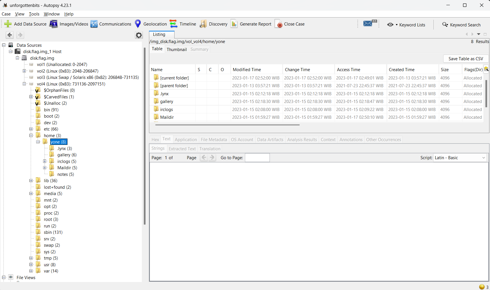

### 2. Read the chat log

I read the chat logs first. The file `irclogs/01/04/#avidreader13.log` is a conversation in which yone explains how he protects his files:

- He hides them in pictures with steghide, using the password `akalibardzyratrundle`.
- He encrypts them with OpenSSL, AES in CBC mode, and gives the salt, key and IV.

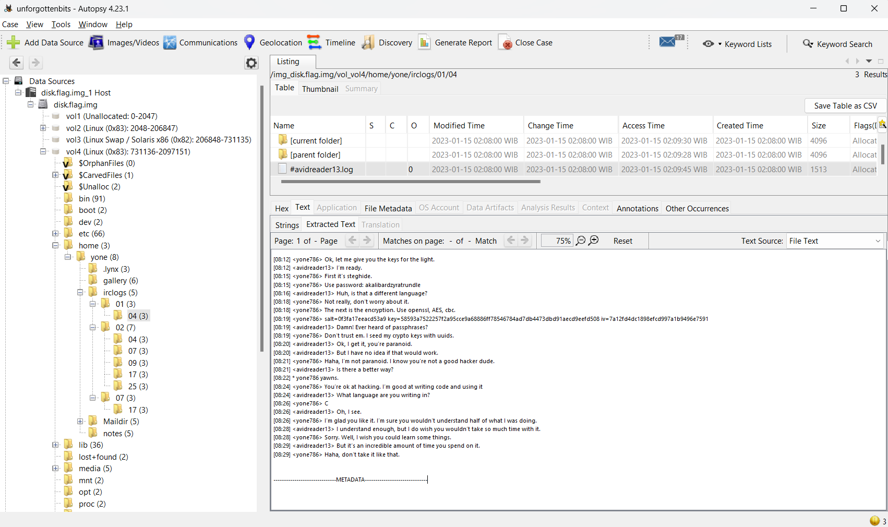

### 3. Extract and decrypt the first three pictures

1. In Autopsy, right-click the `gallery` folder and choose Extract File(s). It holds `1.bmp`, `2.bmp`, `3.bmp` and `7.bmp`.

   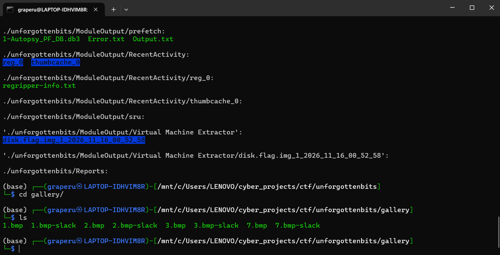
2. In Kali, try the password from the chat log on each picture:

   ```
   steghide extract -sf 1.bmp -p akalibardzyratrundle
   ```

   Pictures 1 to 3 give `les-mis.txt.enc`, `dracula.txt.enc` and `frankenstein.txt.enc`. `7.bmp` rejects the password.

   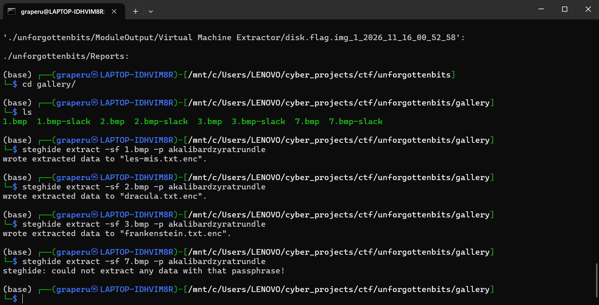
3. Decrypt the three files with the values from the chat log:

   ```
   for f in *.enc; do openssl enc -aes-256-cbc -d -in "$f" -out "${f%.enc}" -S 0f3fa17eeacd53a9 -K 58593a7522257f2a95cce9a68886ff78546784ad7db4473dbd91aecd9eefd508 -iv 7a12fd4dc1898efcd997a1b9496e7591; done
   ```

   I checked the first lines of each file with `head`. Each one is a Project Gutenberg ebook. None of them contains the flag, but they confirm that the method and the key are right.

### 4. Work out the password for 7.bmp

The `notes` folder has three files. `1.txt` and `2.txt` each hold one word, `chizazerite` and `guldulheen`.

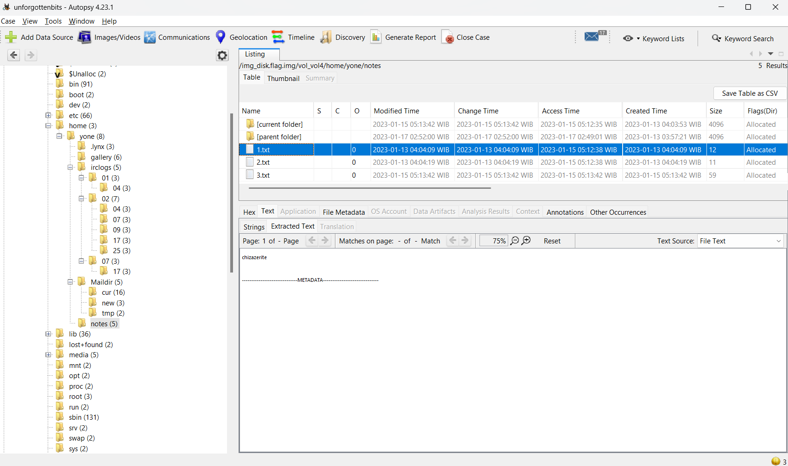

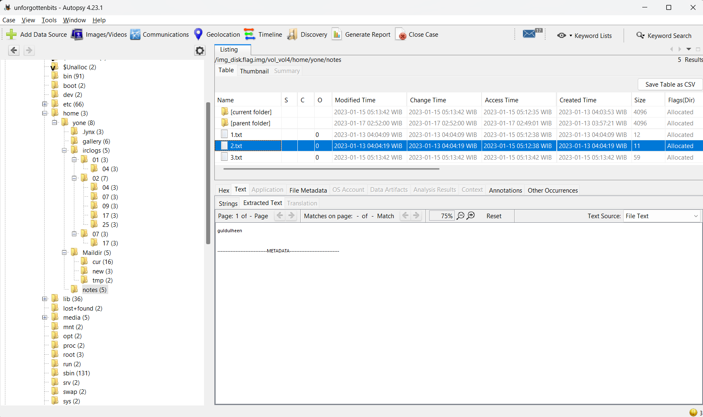

`3.txt` says the password is one yone keeps forgetting, and that it starts with `yasuoaatrox`.

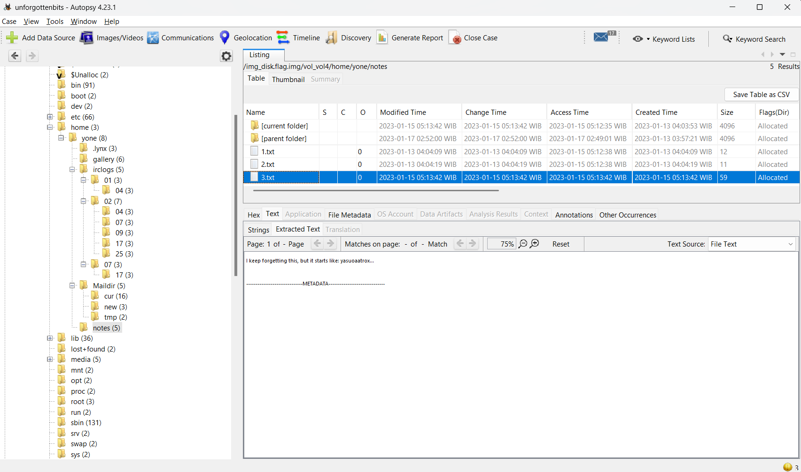

The known password splits into four names: akali, bard, zyra and trundle. These are champions from League of Legends, and so are yasuo and aatrox. The forgotten password is therefore likely to be `yasuoaatrox` followed by two more champion names.

1. Generate every combination with [`gen_wordlist.py`](gen_wordlist.py). With 162 champion names it writes 26,244 candidates:

   ```
   python3 gen_wordlist.py > wordlist.txt
   ```
2. Run StegSeek, which tests steghide passwords from a wordlist. I used it instead of calling steghide once per password because it gets through the whole list in seconds:

   ```
   stegseek 7.bmp wordlist.txt
   ```

   It finds the password `yasuoaatroxashecassiopeia` and extracts a file whose original name is `ledger.1.txt.enc`.

   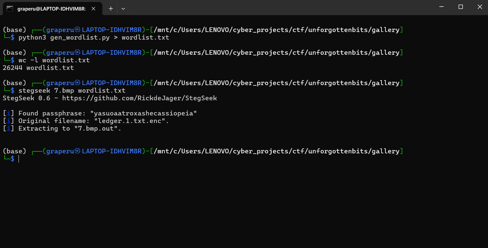

### 5. Try the known key on the ledger

Before looking any further, I tried the salt, key and IV from the chat log on `ledger.1.txt.enc`. The command failed with `bad decrypt` and the output was unreadable, so this file was encrypted with a different key.

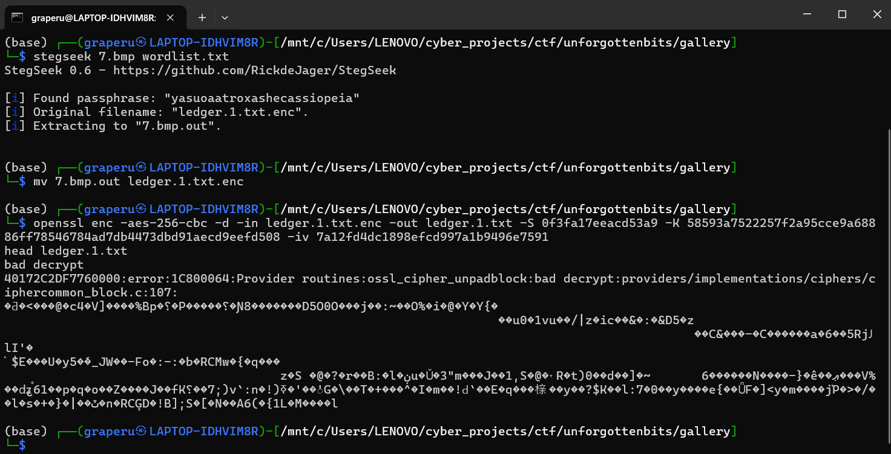

### 6. Find out where the new key is

1. The first email I opened was an advert for football tickets, and most of the mailbox turned out to be the same kind of spam. One real message, signed "The Azerite Master", tells yone to delete all of their emails and empty the trash.

   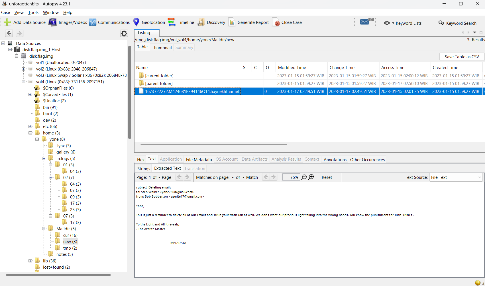
2. Under File Views > Deleted Files, Autopsy lists three deleted emails from `Maildir/cur`. I tried to open them, but their size is 0, so the file system no longer points to their content.

   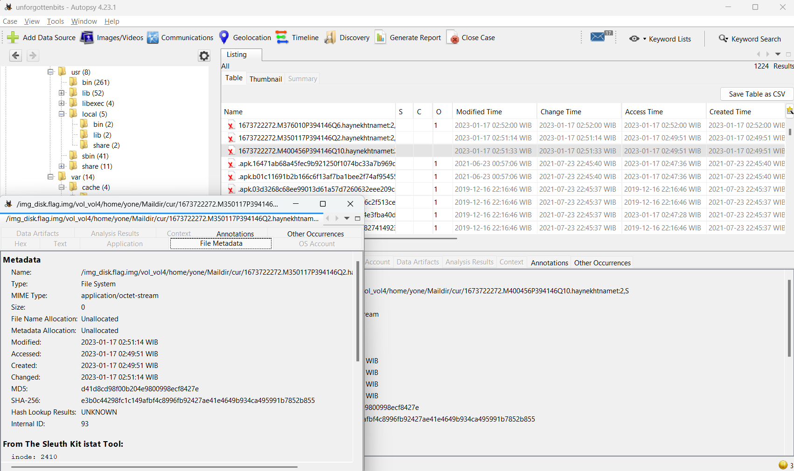
3. The browser history in `.lynx` shows a search for "number encodings" that ends on a page about golden ratio base. This suggests the key is written in that number system, which uses only 0s, 1s and a point.

   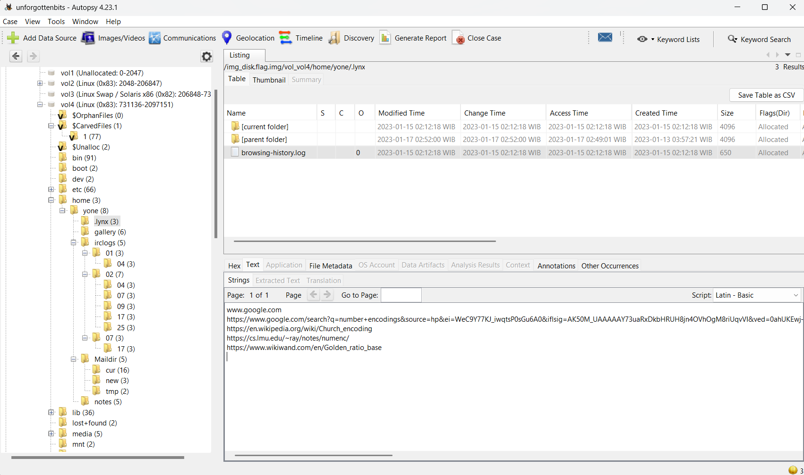

### 7. Recover the encoded key from the raw image

Deleting a file removes its directory entry, not the bytes on the disk. Searching the raw image covers deleted data and unused space as well as normal files:

```
strings disk.flag.img | grep -E "^[01.]{40,}$" > phi.txt
```

My first search ran against the image on the Windows drive, through `/mnt/c`, and was still going after several minutes. I stopped it, copied the image into Kali's own file system and ran the search again from there.

The search returns one long string of 0s, 1s and points, 1,906 bytes in total.

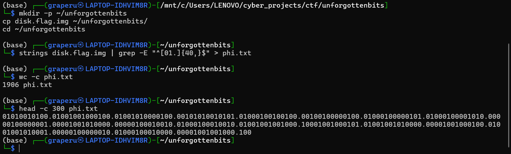

### 8. Decode the key

Each number in the string has 11 digits before the point and 3 after it, and the numbers are written back to back. The first one, `01010010100.010`, comes to about 114.9 in golden ratio base. That rounds to 115, the character code for `s`.

[`decode_phi.py`](decode_phi.py) converts every number to a character:

```python
PHI = (1 + 5 ** 0.5) / 2
INT_DIGITS = 11

chunks = "".join(open("phi.txt").read().split()).split(".")
integers = [chunks[0]] + [c[-INT_DIGITS:] for c in chunks[1:-1]]
fractions = [c[:-INT_DIGITS] for c in chunks[1:-1]] + [chunks[-1]]

text = ""
for whole, frac in zip(integers, fractions):
    value = sum(PHI ** (len(whole) - 1 - i) for i, d in enumerate(whole) if d == "1")
    value += sum(PHI ** -(i + 1) for i, d in enumerate(frac) if d == "1")
    text += chr(round(value))
print(text)
```

The output is a new salt, key and IV:

```
salt=2350e88cbeaf16c9
key=a9f86b874bd927057a05408d274ee3a88a83ad972217b81fdc2bb8e8ca8736da
iv=908458e48fc8db1c5a46f18f0feb119f
```

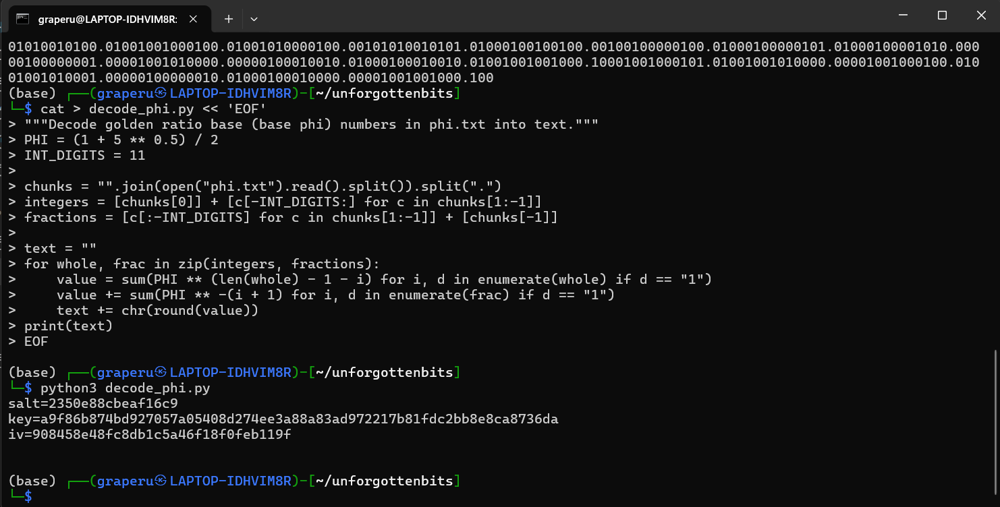

### 9. Decrypt the ledger

```
openssl enc -aes-256-cbc -d -in ledger.1.txt.enc -out ledger.1.txt -S 2350e88cbeaf16c9 -K a9f86b874bd927057a05408d274ee3a88a83ad972217b81fdc2bb8e8ca8736da -iv 908458e48fc8db1c5a46f18f0feb119f
cat ledger.1.txt
```

This time there was no error. The file is a list of customers and the books each one bought, and the last entry holds the flag.

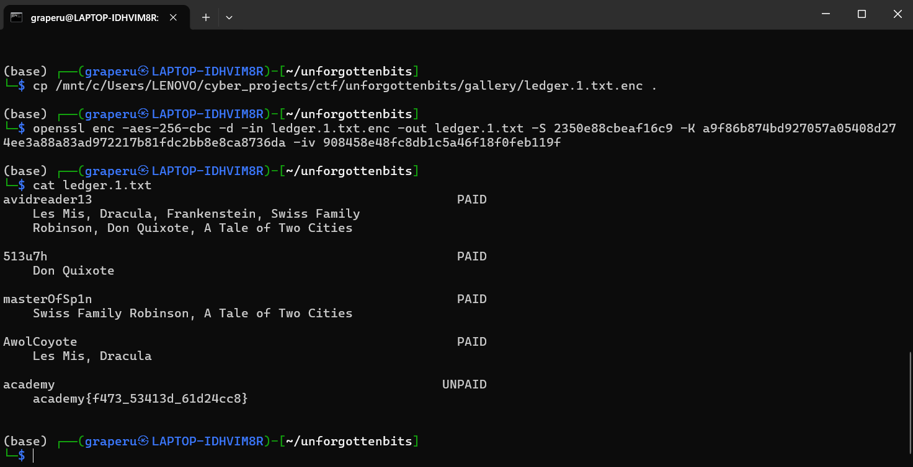

### 10. Submit the flag

The flag is already in the `academy{...}` format, so it can be submitted as it appears in the ledger.

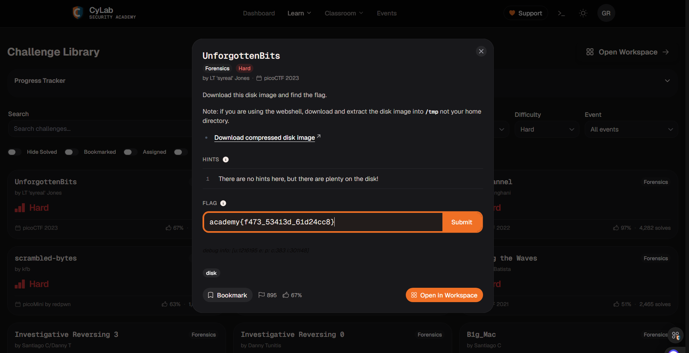

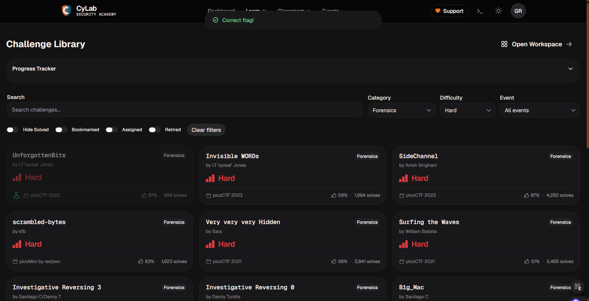

## Result

The flag is `academy{f473_53413d_61d24cc8}`. The platform accepted it.

## Why it works

Three weaknesses in how yone handled his data made the flag recoverable.

He shared secrets in plain text. The chat log gave away the tools, one password and one full set of key material, and nothing on the disk protected that log.

His passwords followed a pattern. Once one password was known to be four champion names, the half-remembered one in `3.txt` left only two names to guess. That is 26,244 possibilities, which a wordlist attack gets through in seconds.

Deleting did not erase. The second key had been removed from the file system, but its bytes were still on the disk, so a search of the raw image found them. Writing the key in golden ratio base hid what it was, not where it was, and the browser history named the encoding.
