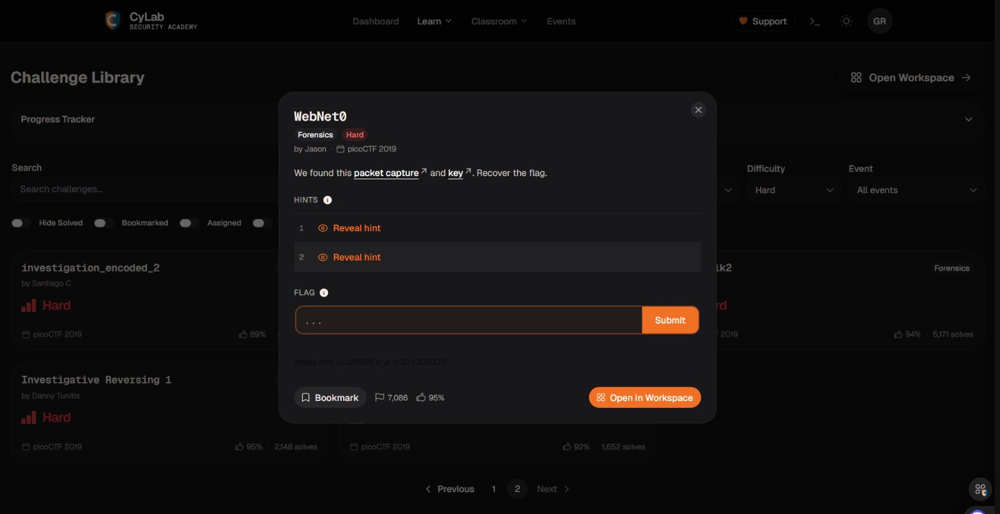
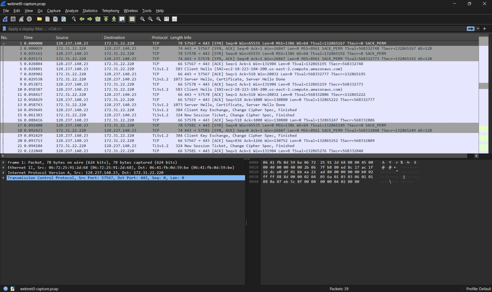
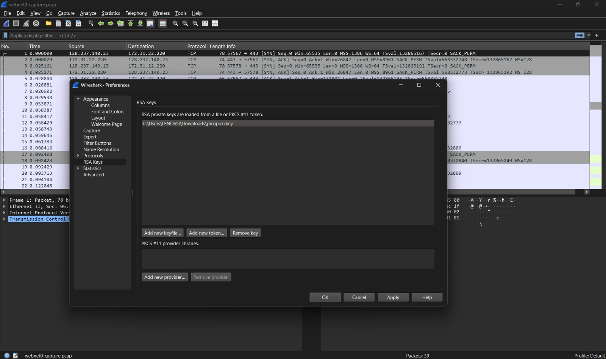
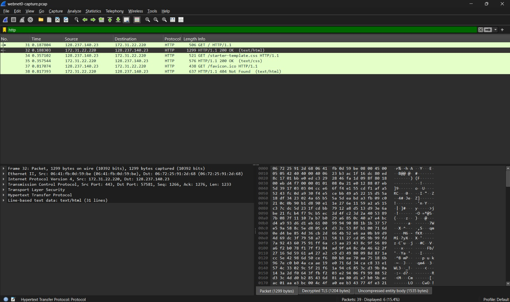
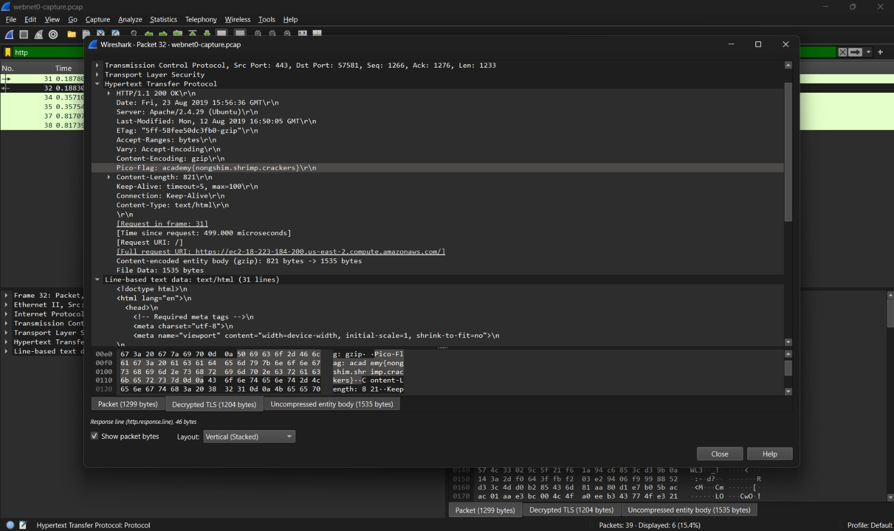
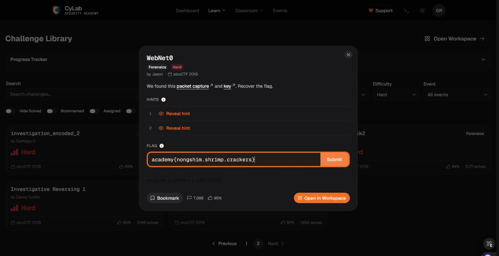
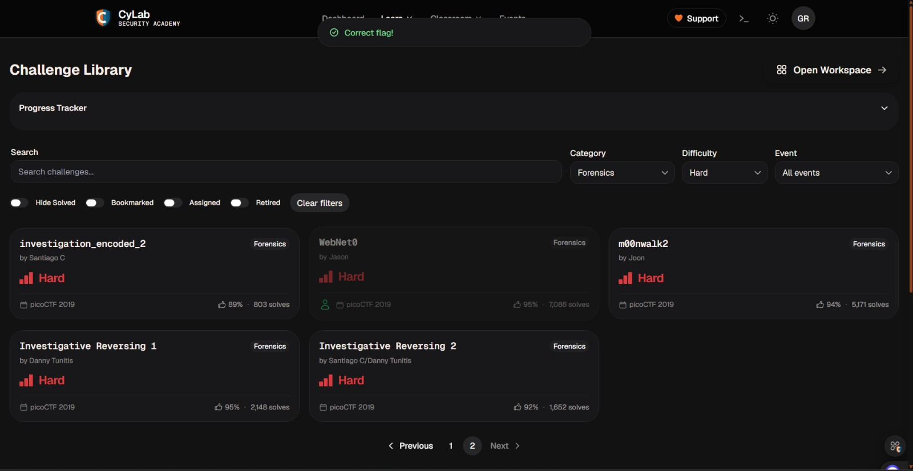

# WebNet0 Proof of Concept

## Challenge information

| Item | Detail |
| --- | --- |
| Challenge | WebNet0 |
| Platform | CyLab Security Academy (formerly picoCTF) |
| Category | Forensics |
| Files provided | A packet capture (`webnet0-capture.pcap`) and an RSA private key (`picopico.key`) |
| Flag format | `academy{...}` |

## Objective

Recover the flag from an HTTPS session recorded in the packet capture. The traffic is encrypted with TLS 1.2, so it has to be decrypted with the server's private key before the HTTP contents can be read.

## Key terms

| Term | Meaning |
| --- | --- |
| Packet capture (pcap) | A file that records network traffic so it can be inspected later. |
| HTTPS | HTTP sent inside an encrypted TLS connection. |
| TLS | The protocol that encrypts traffic between a client and a server. This capture uses version 1.2. |
| Public key and private key | A matching pair of keys. Data encrypted with the server's public key can only be decrypted with its private key, which the server is supposed to keep secret. |
| Key exchange | The part of the TLS handshake where the client and server agree on a shared secret. |
| RSA key exchange | A key exchange where the client chooses the secret, encrypts it with the server's public key, and sends it to the server. |
| Pre-master secret | The secret the client sends during RSA key exchange. |
| Session keys | The keys that encrypt the actual traffic. Both sides calculate them from the pre-master secret. |
| Ephemeral Diffie-Hellman (DHE, ECDHE) | A key exchange where both sides calculate the shared secret from temporary values, so the secret itself is never sent. |

## Tools

Wireshark 4.6.9 on Windows 11.

## Steps

1. Download the packet capture and the private key from the challenge page.
2. Open the capture in Wireshark (File > Open). It contains 39 packets between a client (128.237.140.23) and a server (172.31.22.220) on port 443. The packets show TCP and TLSv1.2 handshakes, and the payload is unreadable.

   
3. Load the private key: Edit > Preferences > RSA Keys > Add new keyfile, select the key file, then click OK.

   
4. Reload the capture with Ctrl+R so Wireshark applies the key.
5. Type `http` in the display filter bar and press Enter. The packets that were encrypted now appear as HTTP requests and responses.

   
6. Select the `HTTP/1.1 200 OK` (text/html) packet and expand Hypertext Transfer Protocol in the packet details pane. The flag is in the `Pico-Flag` response header.

   
7. Submit the flag on the challenge page.

   

   

## Result

The flag is `academy{nongshim.shrimp.crackers}`. The platform accepted it.

## Why it works

The session uses RSA key exchange. In the Client Key Exchange message, the client encrypts a pre-master secret with the server's public key and sends it over the network. Both sides then derive the session keys from that secret.

Anyone who holds the server's private key can decrypt the pre-master secret from a recorded handshake and derive the same session keys. Wireshark does this automatically once the key is loaded, which is why the capture can be decrypted long after the session ended.

This would not work with an ephemeral Diffie-Hellman key exchange (DHE or ECDHE). There the secret is never sent over the network, so the server's private key alone cannot recover it.
