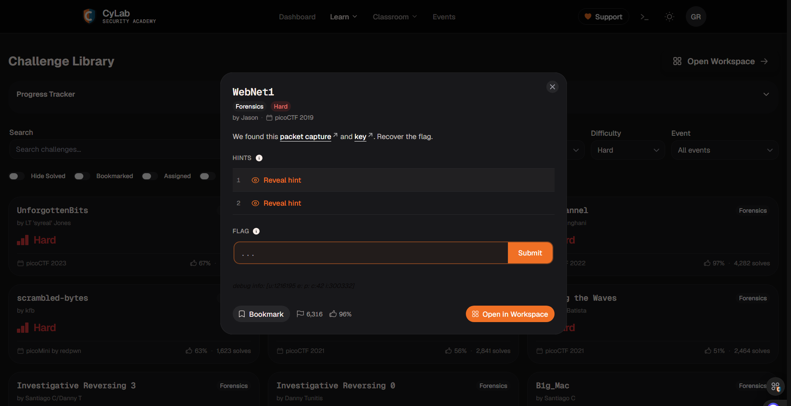
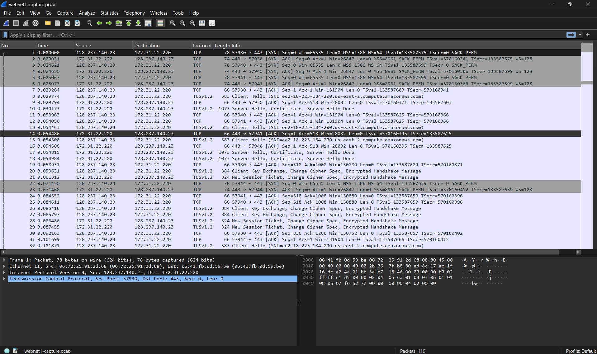
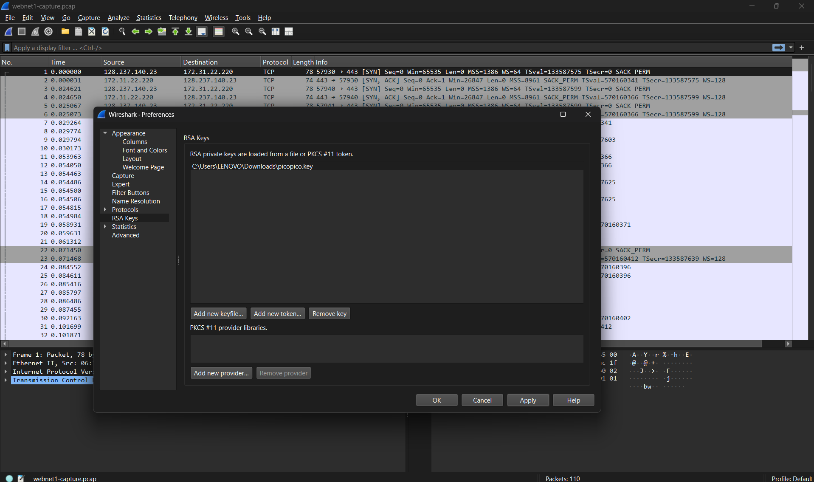
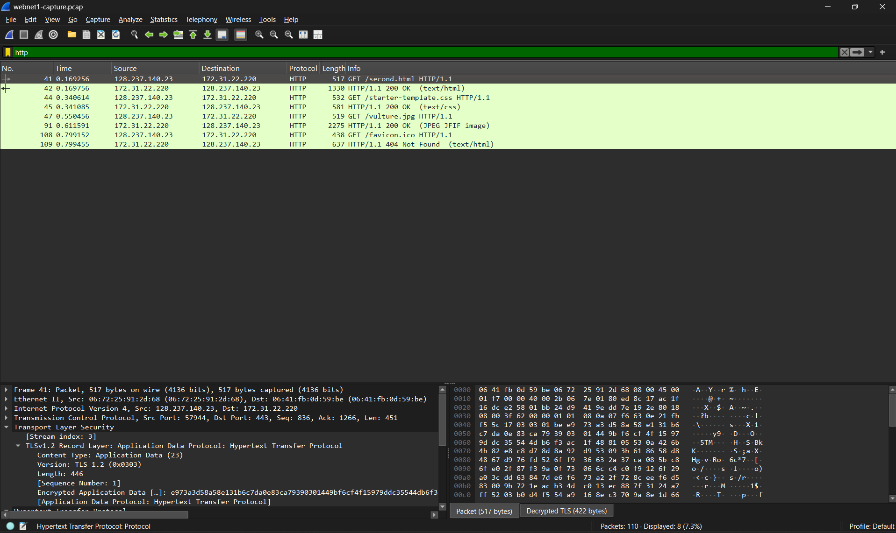
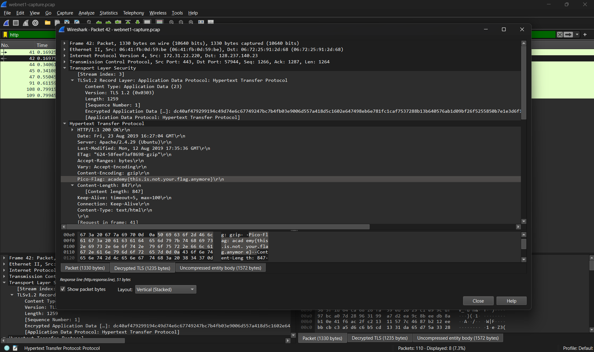
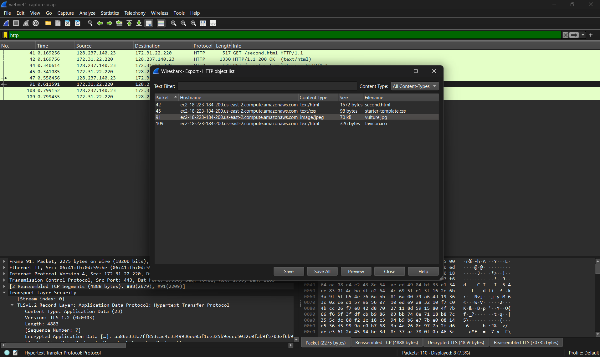
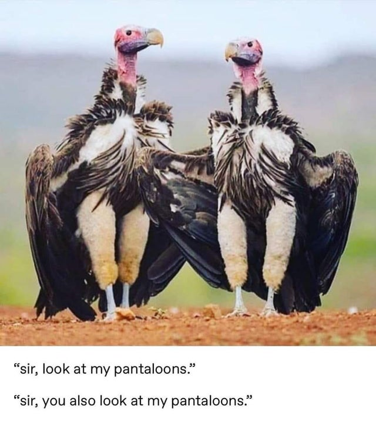
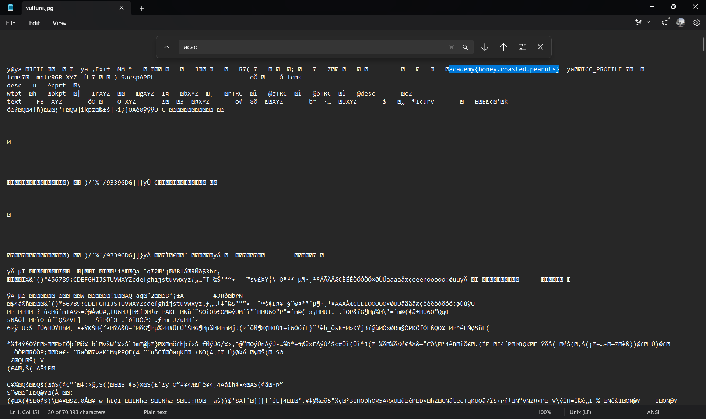
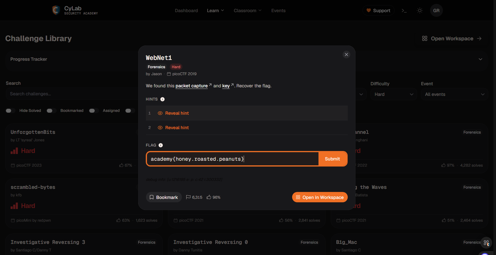
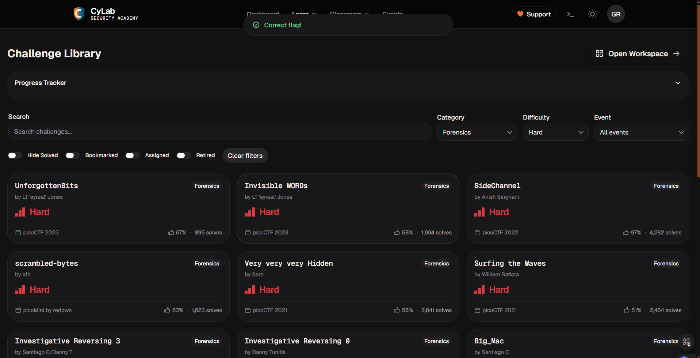

# WebNet1 Proof of Concept

## Challenge information

| Item | Detail |
| --- | --- |
| Challenge | WebNet1 |
| Platform | CyLab Security Academy (formerly picoCTF) |
| Category | Forensics |
| Files provided | A packet capture (`webnet1-capture.pcap`) and an RSA private key (`picopico.key`) |
| Flag format | `academy{...}` |

## Objective

Recover the flag from an HTTPS session recorded in the packet capture. As in [WebNet0](../webnet0/README.md), the traffic has to be decrypted with the server's private key first. This time the flag is not in a response header. It is hidden inside an image that the server sent.

## Key terms

The TLS terms used here (RSA key exchange, pre-master secret, session keys) are defined in the [WebNet0 write-up](../webnet0/README.md#key-terms). Two more apply to this challenge:

| Term | Meaning |
| --- | --- |
| HTTP object | A file carried inside HTTP traffic, such as a page, a stylesheet or an image. Wireshark can rebuild these from a capture and save them to disk. |
| Decoy flag | A value that looks like the flag but is not accepted by the platform. |

## Tools

- Wireshark 4.6.9 on Windows 11
- Notepad

## Steps

1. Download the packet capture and the private key from the challenge page.
2. Open the capture in Wireshark (File > Open). It contains 110 packets between a client (128.237.140.23) and a server (172.31.22.220) on port 443, and the payload is encrypted.

   
3. Load the private key: Edit > Preferences > RSA Keys > Add new keyfile, select the key file, then click OK.

   
4. Reload the capture with Ctrl+R, then type `http` in the display filter bar and press Enter. Eight HTTP packets appear. The client requests `/second.html`, `/starter-template.css`, `/vulture.jpg` and `/favicon.ico`.

   
5. Select the `HTTP/1.1 200 OK` (text/html) packet and expand Hypertext Transfer Protocol. The `Pico-Flag` header is still there, but its value is a decoy, not the flag.

   
6. Export the image the server sent: File > Export Objects > HTTP, select `vulture.jpg`, then click Save.

   

   
7. Open `vulture.jpg` in Notepad (right-click > Open with > Notepad) and press Ctrl+F to search for `academy`. The flag is readable as plain text inside the file.

   
8. Submit the flag on the challenge page.

   

   

## Result

The flag is `academy{honey.roasted.peanuts}`. The platform accepted it.

## Why it works

The decryption works for the same reason as in WebNet0: the session uses RSA key exchange, so the server's private key is enough to recover the session keys from a recorded handshake.

Once the traffic is decrypted, Wireshark can rebuild every file the server sent, including the image. A JPEG file can hold text as well as picture data, and image viewers ignore that text, so the picture looks normal. A text search on the raw file finds it straight away. The same search can be done with `strings vulture.jpg | grep -i pico` in Git Bash, or with a hex editor.
